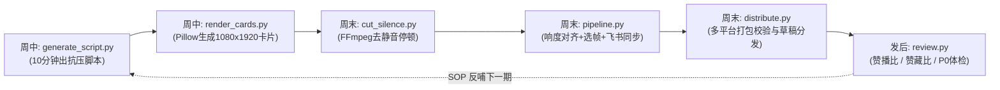

# ECreator Studio · 个人自媒体全链路作战工作流

<p align="center">
  <strong>专为硬核技术人打造的个人自媒体自动化流水线 · 作品主系列：E-Lab (Ethan 实测)</strong><br>
  ECreator Studio 负责工业化生产调度，E-Lab 负责全平台（小红书 / 抖音 / 视频号 / YouTube / X / B站）内容输出
</p>

<p align="center">
  
  
  
  
</p>

---

## 💡 为什么做这个项目？

做自媒体最容易踩两个极端的大坑：
1. **陷入臃肿繁琐的自建泥潭**：自己写数据库、爬虫服务和后台管理，还没发两条视频就把时间耗尽在系统维护上；
2. **陷入低质套壳的商业陷阱**：使用第三方商业套壳软件（美图/开拍/剪映模板），生产出雷同且充满“AI塑料感”的假人假稿，随时面临平台限流。

**ECreator Studio × E-Lab 的核心哲学**：
- **工具与内容双轮驱动**：开源工具链叫 `ECreator Studio`，全平台成片统一归属 `E-Lab` 系列（涵括 AI 硬核实测与反内耗结构思维两条主线）。
- **拒绝玩具 Demo，死磕真实生产力**：以真实翻车实测作为护城河，击穿 AI 虚假营销。
- **飞书为云端总脑，本地为执行中枢**：所有工程状态直接沉淀在飞书多维表格，本地敲一行命令自动咬合。
- **严格适配技术人作息**：**周中 2 晚各 1 小时备料打磨，周末 3.5 小时集中出片，周一发后 15 分钟数据反哺**。

---

## 🛠 工具箱全景 (Toolchain Overview)



| 脚本文件 | 核心职责 | 耗时与机制 |
| :--- | :--- | :--- |
| [`scripts/scout_topics.py`](./scripts/scout_topics.py) | **选题雷达与 85 分 Rubric 评审引擎**：基于 `cheat-on-content` 体系升级 7 维度打分（ER/HP/QL/NA/AB/SR/SAT），扫描 GitHub/HN/HF 实时情报，对齐 `candidate-schema` 协议维护 `candidates.md` 候选池，支持 `--recommend` 智能推荐与 `>=85分` S 级立项 | ~3 秒 |
| [`scripts/transcribe.py`](./scripts/transcribe.py) | **极客音视频抓取与 Whisper 打轴引擎**：整合 `yt-dlp` + `OpenAI Whisper` + `FFmpeg`，秒级扒取 B站/抖音/油管对标视频转写提炼，或为本地口播视频自动生成毫秒级 `.srt` 字幕 | ~5 秒 |
| [`scripts/generate_script.py`](./scripts/generate_script.py) | **10分钟爆款脚本生成引擎**：支持三大赛道（硬核测评 / 省时间 / 加速老赛道），自动生成黄金3秒狠话、短句重音标点、画中画运镜指令及小红书/B站/抖音/YouTube/X 分发包模板 | ~5 秒 |
| [`scripts/render_cards.py`](./scripts/render_cards.py) | **高清对比卡片渲染引擎**：基于 Pillow 渲染 1080x1920 竖版金句卡与对比勾叉表，支持直接导出 FFmpeg MP4 片段 | ~5 秒 |
| [`scripts/cut_silence.py`](./scripts/cut_silence.py) | **智能切除口播气口**：基于 FFmpeg `silencedetect` 自动扫描并切除停顿气口，提升前 5 秒留存 | ~10 秒 |
| [`scripts/pipeline.py`](./scripts/pipeline.py) | **流水线联动控制**：若本机安装外置 `ffmpeg-skill` / `oil-cover`，可串联 `-14 LUFS` 响度标准化、候选帧截取与飞书同步 | ~20 秒 |
| [`scripts/distribute.py`](./scripts/distribute.py) | **多平台打包校验与分发桥接器**：统筹校验 `video_publisher_package.json` 封面比例/标题标签、驱动 `video-publisher` 预填草稿，并联动飞书核对子表回写 | ~15 秒 |
| [`scripts/review.py`](./scripts/review.py) | **数据体检与归因复盘引擎**：量化计算赞播比、赞藏比、转粉率，判定“中长横屏 90 天长效推荐池”，自动输出 🔴 P0 / 🟠 P1 / 🟡 P2 复盘报告 | ~3 秒 |
| [`scripts/feishu_sync.py`](./scripts/feishu_sync.py) | **飞书多维表格云端同步器**：支持同步主表与「分平台分发与数据明细」核对子表（`--sync-platforms`），内置配置文件与环境变量覆盖以方便跨账号复用 | ~5 秒 |
| [`dashboard/index.html`](./dashboard/index.html) | **自媒体闭环运营作战大屏**：清爽亮色系交互看板，内置实时计算器与终端命令备忘 | 双击即开 |

---

## 🚀 快速上手 (Quick Start)

### 1. 环境准备
推荐 **macOS (Apple Silicon)** 或 **Linux**，需提前安装 Python 3.10+ 与 `ffmpeg`（macOS 可执行 `brew install ffmpeg`）：
```bash
git clone https://github.com/MZFL-BH/ecreator-studio.git
cd ecreator-studio
pip install -r requirements.txt
```
> 若要启用浏览自动化与精细剪辑，还需按需安装外部 Skill / CLI：`ego-browser`（飞书与网页发布驱动）、`video-publisher`（多平台自动填表校验），以及可选的 `ffmpeg-skill`、`oil-cover`、`cangshu-koubo-wudongxiao`。

### 2. 标准出片工作流

#### 第零步：选题雷达扫描与 85 分 Rubric 评审
```bash
# 模式 A：扫描 GitHub Trending / Hacker News / Hugging Face 情报
python3 scripts/scout_topics.py --scan

# 模式 B：手动输入任意选题或竞品进行 7 维度打分 (>= 85 分自动入库 candidates.md)
python3 scripts/scout_topics.py "WPS灵犀对比DeepSeek写周报真机实测：模板与避坑SOP" --save

# 模式 C：从已沉淀的 candidates.md 中智能推荐 Top 选题
python3 scripts/scout_topics.py --recommend --limit 5

# 模式 D：遇到优秀竞品/对标视频，一键抓取并用 Whisper 秒级转写提炼 Hook
python3 scripts/transcribe.py "https://v.douyin.com/xxxx/" -o ./benchmarks/
```

#### 第一步：周中初始化选题工程与脚本
```bash
python3 scripts/generate_script.py "公司PPT母版丢给4个AI" -t benchmark -c "低粉爆款对标" -o ./20261030-template-ppt
```
> 输出包含：
> - `script.md`：黄金3秒开门狠话 + 短句带重音 + 嘴角带笑录音指引 + 画中画全屏指示；
> - `publish.md`：小红书大字报文案、B站深度横评简介、抖音/视频号横屏文案。

#### 第二步：周末录制与一键流水线总装
录完出镜和录屏后，丢入工程目录并执行总控流水线：
```bash
python3 scripts/pipeline.py ./20261030-template-ppt
```
- 自动完成 `-14 LUFS` 广播级音频对齐；
- 自动生成 8 候选帧封面建议；
- 自动入库飞书多维表格。

#### 第三步：多平台打包校验与草稿安全分发
```bash
# 1. 仅校验文案权重、标签与多比例封面 (3:4 / 4:3 / 16:9 / 9:16)
python3 scripts/distribute.py ./20261030-template-ppt --platforms xiaohongshu,douyin,wechat_channels,youtube,bilibili,x --check-only

# 2. 联动 video-publisher 上传草稿（默认停在最终发布按钮前）并同步飞书核对子表
python3 scripts/distribute.py ./20261030-template-ppt --platforms xiaohongshu,douyin,wechat_channels,youtube --run --confirm-original-rights --sync-feishu
```
> 跨账号 / 外置技能前置配置说明：
> - **飞书表格切换**：如他人复用，无需修改源码，可在 `~/.config/ecreator-studio/feishu.json`（或通过环境变量 `FEISHU_BASE_URL` / `FEISHU_SUBTABLE_URL` / `FEISHU_FIELD_IDS` / `FEISHU_SUBTABLE_FIELD_IDS`）配置自己的飞书多维表格与字段 ID；工作目录与 Skill 根目录也可通过 `CREATOR_STUDIO_WORKSPACE`、`SKILL_ROOT`、`VIDEO_PUBLISHER_DIR` 覆盖。
> - **外置关联 Skill 依赖**：全流程中的精细口播剪辑依赖 `cangshu-koubo-wudongxiao` / `cangshu-koubo-motion-edit`，多平台浏览器自动填草稿依赖 `video-publisher` 与 `ego-browser`。

#### 第四步：发后 48~72 小时数据体检复盘
```bash
python3 scripts/review.py ./20261030-template-ppt --views 3500 --likes 180 --saves 120 --bounce2s 28.5 --retention5s 36.0
```
- 自动输出 `review.md`，深度穿透是否存在前 2 秒跳出过高、中段完播塌方或赞藏比偏低问题，直接反哺下周周中写稿。

---

## 🛠️ 后续待精进清单 (V2 Roadmap)

- **🎨 封面制作视觉升级（高优）**：当前封面设计仍处于「视频抽帧截图 + 信息卡片叠加」的 v1 阶段，后续需专门核实并精进人物抠像分离度、主视觉对比度、场景道具视觉隐喻与分平台爆款构图。
- **📊 T+3 天分平台数据原行回写**：后续打通 `review.py` 按「选题 + 平台」直接回填「分平台分发与数据明细」子表的播放、点赞、收藏与前 5 秒留存指标。

---

## 📖 核心方法论与参考指南 (References)

项目内置了 6 年自媒体一线实操经验与算法演进总结：
- [01 选题与对标侦察指南](./references/01_topic_research.md)：Mini博主对标法、评论区挖宝三步法；
- [02 脚本与分镜抗压指南](./references/02_script_storyboard.md)：黄金3秒五大范式、标准四列分镜表；
- [03 剪辑与字幕优化指南](./references/03_editing_workflow.md)：响度压制、画中画叠加、Whisper打轴；
- [04 发布分发与数据复盘指南](./references/04_distribution_analytics.md)：小红书/B站/抖音平台差异化文案、指标健康度阈值；
- [05 六年自媒体老兵核心实战铁律](./references/05_veteran_rules.md)：三大黄金选题支柱、口播五大铁律、网感剪辑双杠杆、破除完美主义心法。

---

## 🤖 Antigravity / Agent Skill 交互集成

本项目原生支持作为 **Antigravity / Cursor / Claude Skill** 运行：
- 配置文件：`SKILL.md`
- 交互式门禁：呼叫时自动弹出可视化下拉单选菜单（`ask_question`），一键选择具体执行动作，AI 自动在后台调起对应脚本并汇报执行结果。

---

## 📄 开源许可证

本项目采用 [MIT License](./LICENSE) 协议开源。欢迎 Fork、Star 和贡献代码！

**Author**: Ethan Wang ([@MZFL-BH](https://github.com/MZFL-BH))
